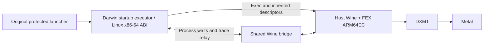

# Architecture and ownership

`src/startup/root.cpp` starts Linux ELF programs and provides the Linux memory, thread, file, and syscall interfaces. After Linux Wine bootstraps the game, the executor hands the protected game exec to host Wine, preserving the PID and inherited file descriptors. The startup processes use Xvfb. Wine and macOS manage the game window.

`src/platform/bridge.cpp` shares one ptrace implementation between native Wine and the startup parent. The parent loads the bridge with `RTLD_LOCAL` and accepts children it actually spawned under the same user. Both sides share register and event layouts through `native-trace-state.h`. The bridge reports actual waits, stops, and exec events. The host game continues after detach. The executor and Wine share path and file identity rules through `file-identity.h`, so the launcher and client see the same original game directory.

`src/platform/elf-carrier.cpp` runs ELF code inside the native Wine process, provides Linux ABI support, and handles thread handoff. The carrier and the startup executor have separate lifecycles and share Linux ABI, network conversion, and file identity code. `runtime-abi.h` defines the PE/Unix call numbers and request layouts.

The shared game directory behaves as a mount in both Linux views. In particular, `readlink` at its root observes the backing directory, not the projection symlink used to assemble the RootFS. This keeps ordinary `realpath` resolution from looping at the mount boundary.

| Component | Responsibility |
|---|---|
| Wine | Windows objects, handles, NT memory, and windows |
| FEX | CPU translation, mappings, and code invalidation on both sides |
| Darwin | Kernel file descriptors, memory, threads, and process waits |
| epoll-shim | Linux readiness events during startup |
| DXMT | Translation from D3D11/10 to Metal |

The build derives private Wine and FEX symbol RVAs from the selected binaries. The Darwin FEX patch translates non-temporal vector accesses after computing the effective address.
